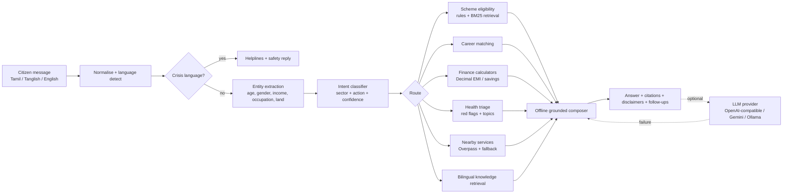

# TamilGPT 2.0

**Tamil-first, offline-capable guidance for everyday decisions in Tamil Nadu.**

TamilGPT 2.0 turns a citizen's question — in Tamil, Tanglish or English — into a
clear next step: which scheme fits, which documents to carry, how much an EMI
costs, whether a symptom needs urgent care, where the nearest office is, and
which helpline to call. It runs with **zero API keys** using a curated bilingual
knowledge base and a deterministic answer composer. An LLM is an optional
upgrade, never a requirement.

> தமிழில் கேளுங்கள். தெளிவான பதில், ஆவணங்கள், தகுதி மற்றும் அடுத்த படி — இணையம்
> இல்லாமலும் வேலை செய்யும் வகையில் வடிவமைக்கப்பட்டது.

[](https://www.python.org/)
[](https://fastapi.tiangolo.com/)
[](#quality-gates)
[](#quality-gates)
[](LICENSE)

---

## Why this exists

Most AI assistants are English-first, cloud-only and opaque about where an
answer came from. TamilGPT 2.0 is built for the opposite constraints:

- **Language first.** Tamil script, romanised Tanglish and English are all
  accepted in the same conversation.
- **Offline first.** The default provider is `offline`; no key, no network and
  no model download is needed for the core experience.
- **Grounded answers.** Every substantive answer carries a source, a next step
  and, where needed, a safety disclaimer.
- **Deterministic money and eligibility.** EMI and savings maths use `Decimal`;
  scheme rules are explicit and testable.
- **Safety is a code path, not a prompt.** Crisis language is detected before
  any other routing and always returns human helplines.

---

## What it covers

Ten citizen-support sectors:

| Sector | Examples of what it handles |
| --- | --- |
| Agriculture | Crop choice, fertiliser, pest control, weather, crop loans, PM-KISAN |
| Education | Admissions, scholarships, exam preparation, education loans |
| Employment | Job search, TNPSC/TRB, interviews, skilling, resumes |
| Business | Starting a small business, MSME support, loan selection |
| Women & Elderly | Girl-child schemes, widow pension, senior-citizen support |
| Government Schemes | Eligibility matching, benefits, documents, application route |
| Legal | Free legal aid, consumer complaints, women's safety, cyber fraud |
| Healthcare | Non-diagnostic symptom guidance, red flags, emergency routing |
| Wellness | Stress, sleep, habits, crisis escalation |
| Finance | EMI, affordability, savings goals, loan comparison, fraud awareness |

The curated knowledge base ships with:

| Dataset | Records |
| --- | ---: |
| Bilingual guidance documents | 50 |
| Government schemes | 23 |
| Career paths | 16 |
| Health topics | 12 |
| Public services | 14 |
| Helplines | 16 |
| Sectors | 10 (+ general routing) |

Records include Tamil and English text, source names, official URLs and an
`updated` date where applicable.

---

## Architecture



### Request pipeline

1. **Validation and normalisation** — Unicode cleanup, Tamil digit folding,
   abbreviation expansion and length limits.
2. **Language detection** — Tamil script, Tanglish lexicon, English or mixed.
3. **Crisis check** — Tamil, Tanglish and English self-harm patterns short-circuit
   the pipeline and return 14416 / 112 / 108 guidance.
4. **Entity extraction** — age, gender, occupation, marital status, monthly or
   annual income, land, education, family size and district.
5. **Intent classification** — sector, action (`information`, `eligibility`,
   `calculation`, `nearby`, `apply`, `documents`, `small_talk`, `crisis`) and
   confidence.
6. **Grounded routing** — scheme rules, BM25 retrieval, deterministic finance,
   health triage, nearby lookup or document search.
7. **Composition** — bilingual answer with citations, disclaimers and suggested
   follow-up questions. The LLM, when enabled, receives the same retrieved
   context under a strict grounding prompt and falls back to offline output on
   any failure.

### Tamil and Tanglish handling

- Tamil ⇄ Latin romanisation with a phonetic key and consonant skeleton, so
  `kalvi kadan`, `கல்விக் கடன்` and spelling variants retrieve the same records.
- BM25 indexes both the original script and a romanised form, with title and
  phrase boosts.
- A bilingual lexicon covers common Tanglish question forms (`enaku`, `vayasu`,
  `penn`, `evlo`, `kidaikkuma`, `thittam`).
- Responses follow the requested language; Tanglish input defaults to Tamil
  output, with English retained where a technical term is clearer.

---

## Quick start

### Local

```bash
python -m venv .venv
source .venv/bin/activate          # Windows: .venv\Scripts\activate
pip install -e ".[dev]"

# Option A — API + bundled web UI
uvicorn tamilgpt.api.main:app --reload

# Option B — installed CLI
tamilgpt serve
```

Open <http://localhost:8000>. The bundled UI uses the same API as any external
client.

### CLI

```bash
tamilgpt chat -m "Enaku 35 vayasu, penn, monthly ₹18,000. Entha thittam kidaikkum?" -l auto
tamilgpt chat -m "EMI for ₹5 lakh at 10% for 5 years" -l en
tamilgpt chat                       # interactive REPL
tamilgpt validate                   # validate every curated dataset
```

### Docker

```bash
docker compose up --build
```

The container runs as a non-root user, drops all capabilities, uses a read-only
filesystem and exposes a `/healthz` health check.

---

## API

Base path: `/api/v1`. Interactive docs are at `/docs` when
`TAMILGPT_ENABLE_DOCS=true` (the default in development).

| Method | Path | Purpose |
| --- | --- | --- |
| `POST` | `/chat` | Ask a question; returns reply, language, intent, citations, disclaimers and follow-ups |
| `GET` | `/sectors` | List the ten sectors with bilingual metadata |
| `GET` | `/schemes` | Search or list schemes (`q`, `category`, `limit`) |
| `POST` | `/schemes/match` | Rank schemes for a citizen profile; `eligible_only` supported |
| `GET` | `/schemes/{id}` | Fetch one scheme |
| `GET` | `/careers` | Search or list career paths |
| `POST` | `/careers/match` | Match careers to education, interests and skills |
| `POST` | `/finance/emi` | EMI, total interest and yearly schedule |
| `POST` | `/finance/affordability` | Safe EMI and maximum loan estimate |
| `POST` | `/finance/savings` | Monthly contribution for a savings goal |
| `POST` | `/finance/compare-loans` | Compare offers by total cost |
| `GET` | `/health/topics` | List non-diagnostic health topics |
| `POST` | `/health/triage` | Red-flag screening and topic guidance |
| `GET` | `/nearby` | Nearby hospitals, police stations and offices |
| `GET` | `/helplines` | Helplines, optionally filtered by category |
| `POST` | `/feedback` | Store a rating and optional comment (PII redacted) |
| `GET` | `/feedback/summary` | Aggregate feedback |
| `GET` | `/meta` | Version, provider and knowledge statistics |
| `GET` | `/metrics` | Process counters and latency percentiles |
| `GET` | `/healthz`, `/readyz` | Liveness and readiness |

### Example

```bash
curl -s http://localhost:8000/api/v1/chat \
  -H 'Content-Type: application/json' \
  -d '{
    "message": "Enaku 35 vayasu, penn, monthly ₹18,000. Entha thittam kidaikkum?",
    "language": "auto"
  }' | python -m json.tool
```

A typical response contains:

- `reply` — the grounded answer in the resolved language
- `language` — `ta`, `en` or `tanglish`
- `intent` — sector, action and confidence
- `citations` — source title and URL
- `disclaimers` — sector-specific safety text
- `followups` — useful next questions
- `crisis` — `true` only for the emergency path

### Scheme matching example

```bash
curl -s http://localhost:8000/api/v1/schemes/match \
  -H 'Content-Type: application/json' \
  -d '{
    "age": 35,
    "gender": "female",
    "monthly_income": 18000,
    "occupation": "tailor",
    "eligible_only": true,
    "limit": 5
  }' | python -m json.tool
```

Each match returns `score`, `eligible`, bilingual `reasons` and the exact
`missing` fields needed to decide eligibility.

---

## Configuration

Every setting is optional. Copy `.env.example` to `.env` only if you want to
override defaults.

| Variable | Default | Notes |
| --- | --- | --- |
| `TAMILGPT_ENV` | `development` | `development`, `test` or `production` |
| `TAMILGPT_HOST` / `TAMILGPT_PORT` | `0.0.0.0` / `8000` | Bind address |
| `TAMILGPT_LOG_LEVEL` | `INFO` | JSON logs in production |
| `TAMILGPT_LLM_PROVIDER` | `offline` | `offline`, `openai`, `gemini`, `ollama` |
| `TAMILGPT_OPENAI_API_KEY` | empty | Enables the OpenAI-compatible provider |
| `TAMILGPT_OPENAI_BASE_URL` | `https://api.openai.com/v1` | Works with Azure, vLLM, Groq, LM Studio |
| `TAMILGPT_OPENAI_MODEL` | `gpt-4o-mini` | Any chat-completions model |
| `TAMILGPT_GEMINI_API_KEY` | empty | Enables Gemini |
| `TAMILGPT_GEMINI_MODEL` | `gemini-1.5-flash` | Gemini model name |
| `TAMILGPT_OLLAMA_BASE_URL` | `http://localhost:11434` | Fully local LLM option |
| `TAMILGPT_OLLAMA_MODEL` | `llama3.1` | Ollama model name |
| `TAMILGPT_API_KEY` | empty | Optional `X-API-Key` protection for non-public routes |
| `TAMILGPT_RATE_LIMIT_PER_MINUTE` | `60` | In-process sliding window per client |
| `TAMILGPT_MAX_QUESTION_CHARS` | `1200` | Hard input limit |
| `TAMILGPT_MAX_HISTORY_TURNS` | `8` | Conversation history sent to the LLM |
| `TAMILGPT_ALLOWED_ORIGINS` | `*` | Comma-separated origins |
| `TAMILGPT_ENABLE_DOCS` | `true` | Disable `/docs`, `/redoc`, `/openapi.json` in production |
| `TAMILGPT_REQUEST_TIMEOUT_SECONDS` | `30` | LLM/network timeout |

**Offline guarantee:** with `TAMILGPT_LLM_PROVIDER=offline` (the default) the
application makes no LLM calls and needs no credentials. `GET /nearby` is the
only route that may use the network (OpenStreetMap Overpass); it degrades
gracefully to official directory links when unavailable.

---

## Safety and privacy

- **Crisis detection runs first.** Tamil, Tanglish and English self-harm phrases
  return Tele-MANAS 14416, emergency 112 and ambulance 108 guidance. The crisis
  path never depends on an LLM.
- **Health is non-diagnostic.** Red-flag symptoms route to 108 or same-day care;
  the response explicitly does not diagnose or prescribe.
- **Sector disclaimers** are attached for health, legal, finance and scheme
  answers. Scheme eligibility is indicative and must be confirmed with the
  official department.
- **PII redaction** removes phone numbers, emails and Aadhaar-like numbers from
  stored feedback.
- **Prompt-injection checks** flag attempts to override instructions.
- **Operational hardening:** request IDs, structured JSON logs, body-size limit,
  rate limiting, restrictive CORS defaults, optional API key, non-root Docker
  user, read-only container filesystem.
- **No telemetry.** The project does not send analytics or conversation data to
  a third party. If you enable a hosted LLM, that provider's policy applies to
  the text you send.

---

## Quality gates

```bash
# Lint
ruff check src tests

# Types
mypy src/tamilgpt

# Tests
pytest

# Tests with coverage threshold
pytest --cov=tamilgpt --cov-report=term-missing --cov-fail-under=70
```

Current state:

- **77 tests passing**
- **91.64% statement + branch coverage**
- **Ruff clean** across `src` and `tests`
- **mypy strict clean** across all 57 source files

The suite covers the API, language detection, transliteration, BM25 retrieval,
entity extraction, scheme rules (including missing-data and mismatch paths),
EMI amortisation, savings, affordability, health triage, career matching,
nearby parsing and fallback, safety helpers, configuration, logging, the CLI and
knowledge validation.

---

## Project layout

```text
.
├── src/tamilgpt/
│   ├── api/
│   │   ├── main.py              # app factory, middleware, static UI
│   │   ├── schemas.py           # request/response models
│   │   ├── serializers.py       # stable JSON shapes
│   │   └── v1/                  # chat, schemes, careers, finance, health…
│   ├── core/                    # config, errors, logging, cache, rate limit
│   ├── knowledge/
│   │   ├── data/                # curated bilingual JSON datasets
│   │   ├── loader.py            # load + index once
│   │   ├── models.py            # typed records
│   │   ├── retriever.py         # BM25 with romanisation expansion
│   │   └── validate.py          # dataset integrity checks
│   ├── llm/                     # optional OpenAI-compatible, Gemini, Ollama
│   ├── nlp/                     # language, normalise, entities, intent, BM25 text
│   ├── services/                # chat, schemes, careers, finance, health, safety…
│   ├── static/                  # bundled web UI and Tamil webfonts
│   ├── sectors.py               # sector catalogue
│   └── __main__.py              # CLI: serve / chat / validate
├── tests/                       # API, NLP, services, knowledge, core
├── Dockerfile
├── docker-compose.yml
├── pyproject.toml
└── tamilgpt 2.0.pptx            # product concept deck
```

---

## Updating the knowledge base

1. Edit the relevant file in `src/tamilgpt/knowledge/data/` (or
   `knowledge/data/docs/` for guidance documents).
2. Keep Tamil and English fields aligned; include an official `source_url` and
   an `updated` date.
3. Run `tamilgpt validate`.
4. Run `pytest`.
5. Restart the API. The knowledge base is loaded once per process and cached.

Validation checks required fields, duplicate IDs, sector references, URL shape
and cross-dataset consistency.

---

## Design decisions

- **Rules before models for eligibility and money.** A citizen can see exactly
  why a scheme matched or failed. Finance uses `Decimal` with half-up rounding,
  so results reconcile with a bank statement.
- **Offline composer is the contract.** The LLM is an optional layer over
  retrieved context; if it is slow, unavailable or ungrounded, the deterministic
  answer is still correct and complete.
- **Retrieval is explainable.** BM25 scores and matched terms are available; no
  embedding service or vector database is required.
- **Bilingual records, not translation at request time.** Both languages are
  curated and stored, avoiding machine-translation drift in safety-critical
  content.
- **Safety text is versioned with the code.** Crisis helplines and disclaimers
  are reviewed like any other source file.

---

## Limitations

- The knowledge base is **curated, not a live government database**. Scheme
  rules, amounts and deadlines change; always confirm on the official portal
  linked in the answer.
- Health guidance is **triage and education only**, never diagnosis or
  prescription.
- Nearby lookup depends on OpenStreetMap coverage and availability; the
  fallback gives directory links and helplines instead of live results.
- Tamil NLP is lexicon, rule and BM25 based rather than a large transformer.
  Very rare Tanglish spellings or code-mixed constructs may fall back to a
  general answer.
- The in-process cache, rate limiter and feedback store are single-node. Use a
  shared backend before scaling horizontally.

---

## Roadmap

- Add district-level service directories and more scheme rules with review dates.
- Expand Tanglish variants from real anonymised query logs.
- Add scheduled link checking for every `source_url`.
- Add a Postgres/Redis backend for multi-node rate limiting and feedback.
- Add evaluation fixtures for answer faithfulness when an LLM is enabled.

---

## License

MIT. See [LICENSE](LICENSE).

Built for Tamil Nadu. Verify every scheme, legal and health decision with the
official source before acting.